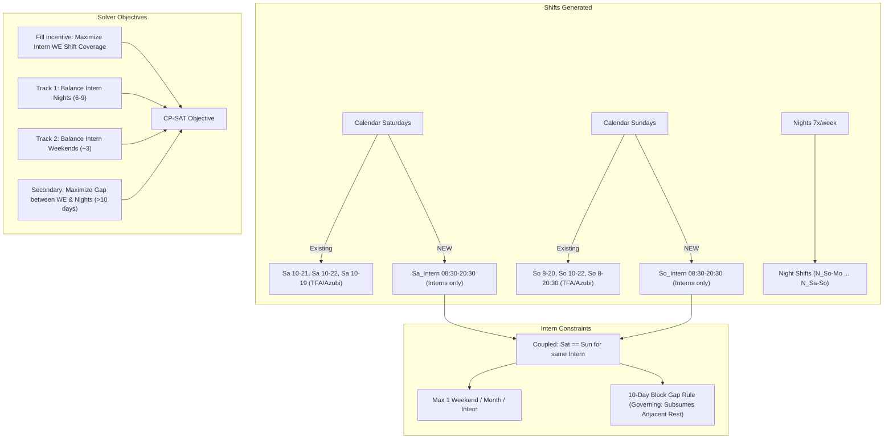

# PRD & Implementation Plan: Intern Vet Weekend Shifts & Two-Track Fairness

**Feature Name**: `intern-weekend-shifts`  
**Status**: Approved Specification / Ready for Implementation (Codebase-Aligned)  
**Target Release**: Version 1.4.0 (Branch 2 of 3)  
**Target Modules**: `app/scheduler/models.py`, `app/scheduler/solver_cpsat.py`, `app/scheduler/validator.py`, `app/scheduler/feasibility.py`, `app/scheduler/file_loader.py`, `app/streamlit_app.py`  

---

## 1. Executive Summary & Business Goals

Management is updating the utilization of Intern Vets (`Beruf.INTERN`). Interns currently work exclusively night shifts (6–9 nights per quarter). Under this new policy:
1. **Dedicated Weekend Shift**: An independent weekend shift type for Interns is introduced for Saturdays and Sundays.
2. **Shift Hours**: **08:30 to 20:30** (12 hours) on both Saturday (`Sa_Intern`) and Sunday (`So_Intern`).
3. **Coupled Weekend Block**: An Intern assigned to a weekend works **both** Saturday and Sunday.
4. **Monthly Cap**: Each Intern works at most **one weekend (Saturday + Sunday) per calendar month** (max 3 weekends per quarter).
5. **Soft / Optional Coverage**: Weekend shifts are not mandatory; if availability/vacations prevent staffing, shifts may remain unassigned, but the solver actively seeks to fill them whenever mathematically and legally possible.
6. **10-Day Block Gap (Option B, Governing / Schlagend)**: For Interns, a maximum of 1 Notdienst (night block or weekend block) is permitted per **10-day rolling window** (instead of the standard 21 days for TFAs/Azubis). This rule is governing and strictly subsumes adjacent night bans; former rule 1.7 (explicit adjacent rest bans) is removed as redundant to reduce implementation complexity.
7. **Two-Track Separate Fairness**: Intern weekend shifts and night shifts are **not** pooled together. Nights are balanced among Interns (6–9 nights), and weekend shifts are balanced separately among Interns (~3 weekends per quarter).
8. **Secondary Spacing Preference**: Beyond the mandatory 10-day gap, the solver softly prioritizes maximizing the distance between an Intern's weekend shift and their night shifts (pushing nights towards ~14 days away).

---

## 2. System Architecture & Shift Model



---

## 3. Detailed Specification of Rules & Constraints

### 3.1 Shift Definitions & Generation (`app/scheduler/models.py`)
- **`ShiftType.SATURDAY_INTERN = "Sa_Intern"`**: Saturday 08:30–20:30.
- **`ShiftType.SUNDAY_INTERN = "So_Intern"`**: Sunday 08:30–20:30.
- **Helper Method on `Shift`**:
  ```python
  def is_intern_weekend_shift(self) -> bool:
      """Check if this is an Intern-specific weekend shift (Sa_Intern or So_Intern)."""
      return self.shift_type in (ShiftType.SATURDAY_INTERN, ShiftType.SUNDAY_INTERN)
  ```
- **Natural Full Weekends Only (Independent of `is_holiday`)**:
  - In `generate_quarter_shifts()`, TFA/Azubi weekend shifts use `if is_holiday: ... elif weekday == 5: ... elif weekday == 6:`. Because a public holiday can fall on a natural Saturday (e.g., Oct 3 or Dec 26), `Sa_Intern` and `So_Intern` **must** be generated in a separate `if weekday == 5:` / `elif weekday == 6:` block **outside** the `if is_holiday:` chain so that a Saturday holiday does not suppress `Sa_Intern` and break the Saturday–Sunday pair.
  - **Quarter-Boundary Guard**: Because Intern weekends are strictly coupled (`Sat == Sun`), `Sa_Intern` on Saturday `d` and `So_Intern` on Sunday `d + 1` are only generated when **both** `d` and `d + 1` fall within `[quarter_start, quarter_end)` (prevents an orphan Sunday on Day 0 if a quarter starts on a Sunday, or an orphan Saturday on Day 90).
  - Weekday public holidays do **not** receive Intern weekend shifts.

### 3.2 Eligibility & Exclusivity (Hard Constraint)
- In `Staff.can_work_shift(shift_type, shift_date)`:
  - If `shift_type in (ShiftType.SATURDAY_INTERN, ShiftType.SUNDAY_INTERN)`: return `self.beruf == Beruf.INTERN` (and `self.adult` if Sunday).
  - For all other weekend shifts (`Sa_10-21`, `Sa_10-22`, `Sa_10-19`, `So_8-20`, `So_10-22`, `So_8-20:30`): Interns remain strictly barred (`if self.beruf == Beruf.INTERN: return False`).
  - TFAs and Azubis cannot work `Sa_Intern` or `So_Intern`.

### 3.3 Coupled Weekend Blocks & Vacation Availability (Hard Constraint)
- An Intern assigned to Saturday must also work Sunday of that same weekend:
  $$\forall s \in \text{Interns}, \quad x[s, d_{\text{Sat}}, \text{Sa\_Intern}] == x[s, d_{\text{Sun}}, \text{So\_Intern}]$$
- **Vacation / Unavailability Guard in Solver**:
  - Since `x` decision variables are only created for non-vacation dates, if an Intern is unavailable on Saturday (`(s, d_Sat, Sa_Intern) not in x`) **or** unavailable on Sunday (`(s, d_Sun, So_Intern) not in x`), the solver must fix the remaining variable of that weekend (if present) to `0`:
    ```python
    if sat_key in x and sun_key in x:
        model.Add(x[sat_key] == x[sun_key])
    elif sat_key in x:
        model.Add(x[sat_key] == 0)
    elif sun_key in x:
        model.Add(x[sun_key] == 0)
    ```

### 3.4 Frequency & Monthly Cap (Hard Constraint)
- A weekend's calendar month $M(w)$ is defined by its **Saturday date** (`d_Sat.month`).
- For each Intern and for each calendar month $M$ present in the quarter:
  $$\sum_{d_{\text{Sat}} \in M} x[s, d_{\text{Sat}}, \text{Sa\_Intern}] \le 1$$
- Total per quarter: at most 3 weekends (6 weekend shifts) per Intern.
- Working 0 weekends in a month is allowed if constrained by vacation or availability.

### 3.5 Optional / Soft Coverage (`solver_cpsat.py` & `validator.py`)
- **Partitioning `weekend_shifts` in `solver_cpsat.py`**:
  - Existing Constraint #1 (`for shift in weekend_shifts: model.Add(sum(staff_for_shift) == target)`) applies **only** to regular TFA/Azubi weekend shifts (`not shift.is_intern_weekend_shift()`).
  - For Intern weekend shifts (`shift.is_intern_weekend_shift()`):
    $$\sum_{s \in \text{Interns}} x[s, d, \text{shift\_type}] \le 1$$
- **High-Priority Objective Fill Incentive ($W_{\text{unfilled}}$)**:
  - For each Saturday `d_Sat` with an Intern weekend shift, define `unfilled_we = model.NewBoolVar(...)` with `model.Add(sum(x[s, d_Sat, Sa_Intern] for s in interns) + unfilled_we == 1)`.
  - Add `W_unfilled * unfilled_we` to `objective_terms` with `W_unfilled = 100_000` (well above fairness range terms `~200–500`, below cross-quarter violation penalty `10_000_000`), ensuring the solver fills every weekend slot unless blocked by vacations or hard constraints.

### 3.6 10-Day Block Gap for Interns & Weekend Isolation Adjustment (Hard Constraint, Governing)
- In `models.py`, add `SchedulerConfig.intern_block_gap_days: int = 10`.
- **Crucial Adjustment to Weekend Isolation (`_add_weekend_isolation_constraints` in `solver_cpsat.py` & `_check_weekend_isolation_constraint` in `validator.py`)**:
  - Currently, `_add_weekend_isolation_constraints` forbids **any** shift on `we_date - 1` or `we_date + 1`. Applied unchanged to `Sa_Intern` and `So_Intern`, it would forbid working both Saturday and Sunday (`x[Sa_Intern] + x[So_Intern] <= 1`), contradicting Rule 3.3 (`x[Sa_Intern] == x[So_Intern]`).
  - Furthermore, `_add_block_constraints` detects block starts via `block_starts[d] = works_on[d] AND NOT works_on[d - 1]`. If an Intern worked `So_Intern` on Sunday and `N_Mo-Di` on Monday, `works_on` would be `1` across `Sat, Sun, Mon, Tue` continuously, producing only **one** `block_start` (on Saturday) and bypassing the 10-day block gap!
  - **Technical Fix**: In both `_add_weekend_isolation_constraints` (`solver_cpsat.py`) and `_check_weekend_isolation_constraint` (`validator.py`), skip the adjacency ban **only** when the two adjacent shifts are `Sa_Intern` on `d` and `So_Intern` on `d + 1` (the coupled Intern weekend pair). All other adjacencies (in particular Friday night `N_Fr-Sa` before `Sa_Intern` and Monday night `N_Mo-Di` after `So_Intern`) remain strictly forbidden by weekend isolation. This guarantees at least 1 off-day (`works_on == 0`) before and after the `[Sa_Intern, So_Intern]` block, so every night block and every weekend block gets its own `block_starts[d] == 1`.
- **Per-Role Gap in `_add_block_constraints` (`solver_cpsat.py`), `find_cross_quarter_block_gap_exceptions` & `_check_three_week_block_constraint` (`validator.py`), and `analyze_capacity` (`feasibility.py`)**:
  - Inside the `for staff in staff_list:` loop in `_add_block_constraints`:
    ```python
    staff_gap_days = (
        intern_block_gap_days
        if staff.beruf == Beruf.INTERN
        else gap_days
    )
    ```
  - Use `staff_gap_days` (10 for `Beruf.INTERN`, 21 for `TFA`/`Azubi`) for trailing-date window filtering (`(quarter_start - d).days <= staff_gap_days`) and block-start gap enforcement (`required_gap`).
  - Update `_check_three_week_block_constraint(schedule, staff_dict, config)` in `validator.py`, `find_cross_quarter_block_gap_exceptions(schedule, previous_context, config, staff_list)` in `validator.py`, and `_count_viable_blocks` call in `feasibility.py` to use `config.intern_block_gap_days` for `Beruf.INTERN`.
- **Subsumption of Adjacent Rest Bans**: With weekend isolation preserving the boundary around `[Sa_Intern, So_Intern]` and `_add_block_constraints` enforcing a 10-day start-to-start gap, any night block is at least 10 days from Saturday (i.e. ≥8 days after Sunday), completely subsuming explicit adjacent rest bans.

### 3.7 Two-Track Fairness (Objective, Carry-Forward & UI)
- **Solver Fairness Separation (`solver_cpsat.py`)**:
  - Currently, `notdienst_half_counts` sums `weekend_terms + night_terms` for all staff, and passes `notdienst_half_counts` into `_add_group_fairness_objective_with_presence` for `Intern`.
  - **Track 1 (Intern Night Shifts)**:
    - Pass **`night_half_counts`** (instead of `notdienst_half_counts`) into `_add_group_fairness_objective_with_presence` for `group_name == "Intern"` so weekend shifts never dilute night shift fairness.
    - Interns continue working 6–9 night shifts per quarter (`intern_min_nights` / `intern_max_nights`), with open nights (`N_So-Mo`, `N_Mo-Di`) weighted at 2 half-units (1.0 effective night) per `FEATURE_OPEN_CLOSED_NIGHTS.md`.
  - **Track 2 (Intern Weekend Shifts)**:
    - Add a dedicated min-max fairness term over `weekend_half_counts` (or weekend block counts `0..3`) for `intern_staff` (with `len(intern_staff) >= 2`), weighted by `W_intern_we_fairness = 100` in `objective_terms` (no hard `range_var <= threshold` cap needed since monthly cap already bounds counts to `0..3`).
- **Carry-Forward (`compute_carry_forward` in `models.py`) & Validator (`_calculate_soft_penalty` in `validator.py`)**:
  - In `compute_carry_forward()`: For `staff.beruf == Beruf.INTERN`, `normalized_40h` and `carry_forward_delta` (which feed Track 1 night fairness in the next quarter) must be computed from **`effective_nights` only** (excluding `weekend_shifts`), preserving Two-Track separation across quarters (`weekend_shifts` is still recorded in `CarryForwardEntry.weekend_shifts` for display).
  - In `validator._calculate_soft_penalty()`: Compute group std-dev penalty for `Beruf.INTERN` separately on `count_effective_nights` (Track 1) and `count_weekend_shifts` (Track 2) rather than pooling them.

### 3.8 Secondary Spacing Maximization (Objective)
- For each Intern $s$, each Saturday $d_{\text{Sat}}$ (where `sat_key = (s, d_Sat, Sa_Intern)` is in `x`), and each night shift $d_{\text{Night}}$ (where `night_key` is in `x`):
  - If $10 \le |d_{\text{Night}} - d_{\text{Sat}}| < 14$ (or $10 \le (d_{\text{Sat}} - d_{\text{Night}}) < 14$ / $10 \le (d_{\text{Night}} - d_{\text{Sat}}) < 14$):
  - Create indicator `close_var = model.NewBoolVar(...)` with `model.AddBoolAnd([x[sat_key], x[night_key]]).OnlyEnforceIf(close_var)` (or `model.Add(x[sat_key] + x[night_key] - 1 <= close_var)`).
  - Add `W_intern_spacing * (14 - gap) * close_var` (with `W_intern_spacing = 5`) to `objective_terms`, softly pushing night blocks ≥14 days away from an Intern's weekend block whenever possible.

---

## 4. Codebase Implementation Plan

```
app/
├── scheduler/
│   ├── models.py
│   │   ├── Add ShiftType.SATURDAY_INTERN = "Sa_Intern" & ShiftType.SUNDAY_INTERN = "So_Intern"
│   │   ├── Add Shift.is_intern_weekend_shift() -> bool
│   │   ├── Update Staff.can_work_shift() to allow Interns only on Sa_Intern / So_Intern among WE shifts
│   │   ├── Update generate_quarter_shifts() to generate Sa_Intern / So_Intern on natural full weekends (independent of is_holiday)
│   │   ├── Update compute_carry_forward() to keep Intern normalized_40h on Track 1 (effective_nights only)
│   │   └── Add intern_block_gap_days: int = 10 to SchedulerConfig
│   ├── solver_cpsat.py
│   │   ├── Partition weekend_shifts into regular_weekend_shifts (== target) and intern_weekend_shifts (<= 1)
│   │   ├── Add coupled weekend constraint (x[s, Sat, Sa_Intern] == x[s, Sun, So_Intern], or 0 if one day on vacation)
│   │   ├── Add soft coverage fill penalty (W_unfilled = 100_000 per unassigned Intern weekend)
│   │   ├── Add monthly cap constraint (<= 1 Sa_Intern per calendar month per Intern)
│   │   ├── Update _add_weekend_isolation_constraints() to allow Sa_Intern <-> So_Intern adjacency while blocking Fri/Mon nights
│   │   ├── Update _add_block_constraints() to use intern_block_gap_days (10 days) for Beruf.INTERN
│   │   ├── Update Track 1 Intern fairness to use night_half_counts (not pooled notdienst_half_counts)
│   │   ├── Add Track 2 Intern weekend fairness objective (min-max range of Intern weekend counts)
│   │   └── Add secondary distance maximization objective (penalize Intern nights within 10–13 days of Sa_Intern)
│   ├── validator.py
│   │   ├── Update validate_schedule() signature to accept config: SchedulerConfig | None = None
│   │   ├── Update _check_intern_weekend_constraint() (allow Sa_Intern/So_Intern for Interns, forbid other WE shifts)
│   │   ├── Add _check_intern_coupled_weekend_constraint() (Sat == Sun for same Intern)
│   │   ├── Add _check_intern_monthly_weekend_cap() (<= 1 coupled weekend per calendar month per Intern)
│   │   ├── Update _check_weekend_isolation_constraint() to allow Sa_Intern + So_Intern pair while forbidding adjacent nights
│   │   └── Update _check_three_week_block_constraint() & find_cross_quarter_block_gap_exceptions() for intern_block_gap_days
│   ├── feasibility.py
│   │   ├── Pass config.intern_block_gap_days to _count_viable_blocks() for Beruf.INTERN
│   │   └── Update Check D (Intern capacity) to report both night (6–9/quarter) and weekend (<=1/month) capacity
│   └── file_loader.py
│       └── Support Sa_Intern and So_Intern in parse_previous_plan_xlsx() (automatic via ShiftType enum)
└── streamlit_app.py
    ├── Add (ShiftType.SATURDAY_INTERN, "☀️ Sa 08:30-20:30: Intern") & (ShiftType.SUNDAY_INTERN, "☀️ So 08:30-20:30: Intern") (or combined column) in Plan anzeigen
    ├── Display separate Intern Track 1 (Nächte) vs Track 2 (Wochenenden) fairness metrics in tab_stats
    ├── Add intern_block_gap_days number_input (default 10) in Erweiterte Einstellungen
    ├── Update page_regeln() and known_constraints dict in tab_validation
    └── Include Intern weekend shifts automatically in Excel "Wochenenddienste" export sheet
```

---

## 5. Verification & Test Plan

1. **Unit Tests (`tests/test_scheduler.py`)**:
   - `test_intern_weekend_eligibility`: Verify Intern can be assigned to `Sa_Intern` and `So_Intern`, but not to `Sa_10-21`, etc.
   - `test_intern_weekend_coupling`: Verify Saturday and Sunday are always assigned to the same Intern.
   - `test_intern_weekend_monthly_cap`: Verify no Intern receives >1 weekend in any calendar month.
   - `test_intern_10_day_block_gap`: Verify blocks for Interns respect the 10-day gap (and that this inherently prevents adjacent night shifts) without triggering false 21-day violations.
   - `test_intern_two_track_fairness`: Verify night fairness and weekend fairness are optimized independently without cross-dilution.
   - `test_intern_soft_coverage`: Verify solver runs and succeeds even if an Intern has heavy vacation in a month.
2. **Validator Tests**:
   - Verify that invalid manual schedules (e.g. Saturday without Sunday, >1 weekend/month, or block gap violation <10 days) are caught with clear error messages.
3. **UI & Export Tests**:
   - Verify that Streamlit calendar renders the new column and Excel export includes `Sa_Intern` / `So_Intern` under `Wochenenddienste`.
