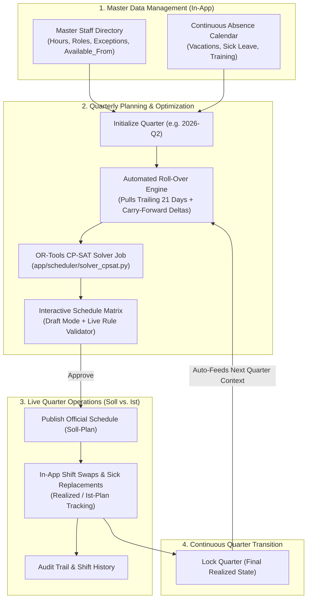
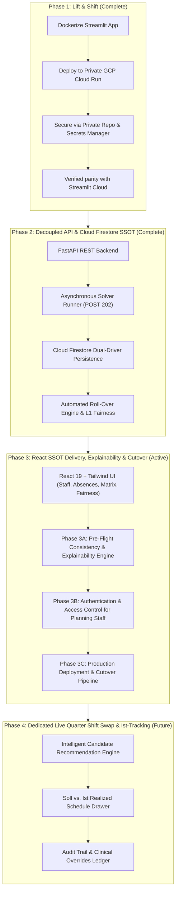
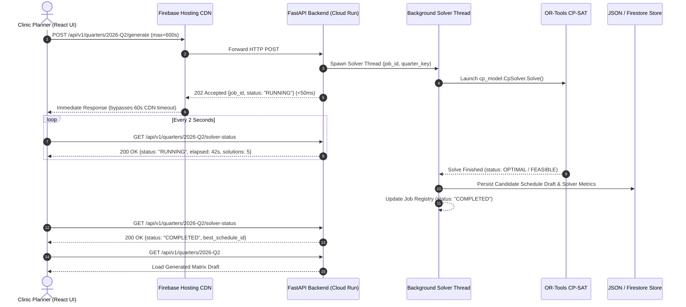
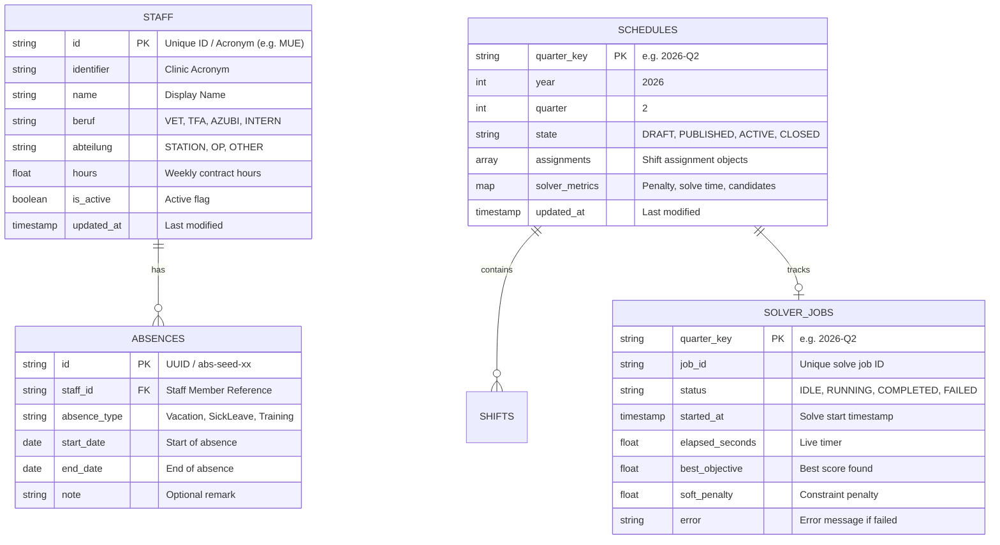

# Product Requirements Document (PRD)
# Cloud Run Deployment & Frontend Modernization Roadmap
## Transforming the Dienstplan Generator into a Unified Single Source of Truth (SSOT)

**Feature Name / Slug**: `gcp-cloud-run-migration-and-modernization`  
**Document Version**: 1.5 (Updated: Stakeholder UI Ergonomics, 3-Column Schedule Redesign, Streamlined Workflows & Ad-hoc Shift Backlog)  
**Status**: Approved & In Progress (Phase 1, 2, and 3 Complete; Phase 4 Dedicated Shift Swap Active)  
**Target Architecture**: GCP Cloud Run (Containerized Backend) + GCP Cloud Firestore (Serverless Document Database with Local JSON Fallback) + Modern React/Tailwind Frontend (Firebase Hosting)  
**Author**: Antigravity / Senior Cloud & Full-Stack Architect  

---

## 1. Executive Summary & Business Drivers

### 1.1 Motivation & Context
The **Dienstplan Generator** is currently written in Streamlit and deployed on Streamlit Community Cloud. While it successfully solves the complex mathematical optimization problem of fair quarterly emergency and night shifts using OR-Tools CP-SAT, its current operational workflow is that of a **"stateless calculator"**. 

This operational model suffers from two major categories of friction:

#### A. Cloud Infrastructure & Privacy Risks
1. **Repository Privacy & Data Sensitivity**: Streamlit Community Cloud enforces public repositories for free tier hosting. Even with sample data, hosting clinical shift scheduling logic, employee names, initials, and operational constraints in a public repository is unacceptable from an IP and data protection perspective. Migrating to Google Cloud Platform (GCP) allows keeping the source code and clinic data in a private repository and private container registry.
2. **Volatile Execution Environment**: Streamlit relies purely on in-memory `st.session_state`. When a browser tab is refreshed, or when the container sleeps/reboots, all in-session inputs (uploaded staff lists, vacations, trailing quarter contexts, and generated schedules) are lost.
3. **Compute & Solver Constraints**: The CP-SAT constraint programming solver (`ortools`) is CPU- and memory-intensive (runs typically 60–120 seconds). Running this inside a lightweight shared multi-tenant environment risks throttling, memory kills, or WebSocket disconnection.

#### B. Workflow Fragmentation & The "Excel Hell" Problem
Currently, the quarterly scheduling workflow requires extensive manual work **outside** the application:
1. **Disconnected Employee Rosters**: Planners maintain local `staff.csv` or `staff.xlsx` files. Updates to employee hours, new hires (`available_from`), departures, or qualification changes happen in local spreadsheets and must be re-uploaded every session.
2. **Disconnected Vacation Calendars**: Vacations are tracked separately in `vacations.xlsx` and manually fed into the app per quarter.
3. **Local Editing of the "Realized Schedule" (Ist-Plan)**: After the solver creates a plan and it is exported to Excel (`Dienstplan_2026_Q1.xlsx`), clinical reality intervenes during the quarter (sick leave, emergency shift swaps, staff departures). Planners currently edit these changes locally in Excel.
4. **Manual Cross-Quarter Bridging**: When planning the next quarter (e.g. Q2), the planner must remember to upload the manually edited *Arbeitseinsätze* Excel file from Q1 as the "Context File" (`build_previous_context_from_xlsx`). If this file is missing, formatted incorrectly, or outdated, **the 21-day rest constraint across the quarter boundary and the FTE carry-forward fairness deltas are completely lost**.

### 1.2 The Vision: A Single Source of Truth (SSOT)
The objective is to evolve the Dienstplan Generator from a stateless calculation tool into an **all-in-one cloud scheduling platform** for the clinic planning team:
- **Zero local spreadsheet dependencies** for recurring operations (Excel becomes an optional export format, not a storage medium).
- **In-app Master Staff Management** (hire dates, hours adjustments, roles, exceptions).
- **In-app Continuous Vacation & Absence Calendar**.
- **In-app Shift Swap & Sickness Tracking ("Soll vs. Ist")** during the active quarter.
- **Automated 1-Click Quarter Roll-Over**: When starting Q2, the system automatically pulls the locked realized shifts and trailing 21 days from Q1 to enforce boundary constraints and carry-forward fairness without any manual file juggling.

---

## 2. Complete Schedule Lifecycle Architecture

The following diagram illustrates how the target platform replaces external file hand-offs with an end-to-end cloud lifecycle:



### 2.1 Workflow Comparison: Today vs. Target SSOT Platform

| Step | Current Workflow (External Files) | Target SSOT Platform (In-App) |
|:---|:---|:---|
| **Staff Management** | Edit local `staff.csv`, upload per session | In-app Employee Management UI; changes persist automatically |
| **Vacation Tracking** | Edit local `vacations.xlsx`, upload per session | In-app Vacation Calendar; recurring & future leaves pre-stored |
| **Schedule Generation** | Streamlit button, browser blocks during solve | Asynchronous Background Solver Job (`POST /quarters/{key}/generate` returns `202 Accepted` with `job_id`; frontend polls status or receives updates; background thread with `--no-cpu-throttling` withstanding 10-minute solves) |
| **Manual Adjustments** | Export to Excel or use clumsy Streamlit widgets | Interactive React grid with drag-and-drop & live constraint feedback |
| **Quarter Operations** | Planners edit exported Excel file on desktop when shifts swap or sick leave occurs | Planners log swaps and sick replacements directly in the live schedule matrix |
| **Quarter Roll-Over** | Manually upload Q1 *Arbeitseinsätze* Excel into Q2 Streamlit session | 1-Click Roll-Over: system automatically reads Q1 realized shifts, builds `PreviousPlanContext`, and initializes Q2 |
| **Excel Role** | Primary storage & communication medium | Read-only export for noticeboard printouts and external archiving |

---

## 3. Phased Implementation Strategy

To protect ongoing clinical operations and avoid disruption, the modernization roadmap is structured in four clear, safe phases:



- **Phase 1 (Complete)**: Containerized the existing Streamlit app and deployed it to private Cloud Run with zero disruption.
- **Phase 2 (Complete)**: Built the headless FastAPI REST API, asynchronous background solver engine with live polling (`POST 202` + `/solver-status`), Google Cloud Firestore persistence with local JSON fallback, automated quarter roll-over, and $L_1$-penalized CP-SAT fairness optimization.
- **Phase 3 (Active)**: Completes the transition to the React Single Source of Truth (SSOT) web application:
  - **Phase 3A (Solver Explainability & Pre-Flight Engine)**: Pinpoints and explains infeasibility causes (conflicting pre-assignments, coverage deficits, qualification bottlenecks) *before* or *during* CP-SAT execution with clear clinical diagnostic guidance.
  - **Phase 3B (Authentication & Planning Staff Logins)**: Multi-user login protecting administrative scheduling operations (staff edits, vacation approvals, solver execution) via role-based access control (`Planner` vs. `Viewer`).
  - **Phase 3C (Production Deployment & Cutover Pipeline)**: Automated build and release pipeline targeting Firebase Hosting (Frontend) and Cloud Run Production (`dienstplan-app`).
- **Phase 4 (Future Dedicated Feature)**: Moves live shift swaps and realized sickness tracking ("Soll vs. Ist") into a separate, dedicated milestone once the primary planning workflow is production-verified. Shift swap UI controls are intentionally removed from the initial release to maintain focus and quality.

---

## 4. Phase 1: Containerized Streamlit on GCP Cloud Run

### 4.1 Objectives
- Deploy the existing Streamlit app inside a secure, private GCP project.
- Host source code in a private GitHub repository; store containers in GCP Artifact Registry.
- Guarantee 100% feature parity with zero user disruption.

### 4.2 Cloud Run Service Specification
| Parameter | Specification | Rational / Justification |
|:---|:---|:---|
| **Service Name** | `dienstplan-app` | Primary scheduling service |
| **Region** | `europe-west3` (Frankfurt) or `europe-west1` (Belgium) | Low latency, strict EU GDPR compliance |
| **CPU Allocation & Throttling** | 2 vCPU, Always Allocated (`--no-cpu-throttling`) | Dedicated CPU cores for OR-Tools CP-SAT; `--no-cpu-throttling` is mandatory so background solver threads continue running after HTTP 202 is returned |
| **Memory** | 4 GiB | Headroom for deep CP-SAT branch-and-bound search trees, preventing OOM kills (exit 137) during 10-minute solves |
| **Execution Environment** | Second Generation (`gen2`) | Full Linux syscall and memory bandwidth compatibility |
| **Request Timeout** | 900 seconds (15 min) | Generous container lifetime accommodating long solves up to 10 minutes |
| **Concurrency** | 2 | Limits concurrent compute jobs per container, preventing CPU starvation and heartbeat drops |
| **Session Affinity** | Enabled (`--session-affinity`) | Critical for Streamlit WebSockets across client reconnects |
| **Min Instances** | 0 (cost-effective) or 1 (instant) | Min 0 scales to zero when idle; Min 1 eliminates cold-start latency |
| **Max Instances** | 3 | Prevents accidental cost runaway |

### 4.3 Container Hardening (`Dockerfile` Updates)
The updated `Dockerfile` for Phase 1 must support:
- Dynamic `$PORT` binding provided by Cloud Run with fallback to `8080`.
- Streamlit production flags (`--server.enableCORS=false`, `--server.headless=true`).
- Installing all required dependencies (`matplotlib`, `ortools`, `xlsxwriter`, `pandas`, `openpyxl`, `pydantic`).

```dockerfile
FROM python:3.11-slim

WORKDIR /app

# Prevent Python from writing .pyc and buffer output for Cloud Logging
ENV PYTHONDONTWRITEBYTECODE=1 \
    PYTHONUNBUFFERED=1 \
    PORT=8080

# Install dependencies
COPY pyproject.toml .
RUN pip install --no-cache-dir \
    streamlit>=1.30.0 \
    pandas>=2.1.0 \
    openpyxl>=3.1.0 \
    pydantic>=2.5.0 \
    python-dateutil>=2.8.0 \
    xlsxwriter>=3.0.0 \
    matplotlib>=3.8.0 \
    ortools>=9.15.6755

# Copy application source
COPY app/ ./app/

# Create data directory if not present
RUN mkdir -p /app/data

EXPOSE 8080

# Run Streamlit bound to Cloud Run dynamic $PORT
CMD ["sh", "-c", "streamlit run app/streamlit_app.py --server.port=${PORT} --server.address=0.0.0.0 --server.enableCORS=false --server.headless=true"]
```

### 4.4 Dual-Environment Cloud Run Strategy (Zero-Risk Parallel Deployments)
To enable active development and validation without risking production downtime or breaking changes to active scheduling sessions, the infrastructure uses two distinct Cloud Run services:
1. **Production Service (`dienstplan-app`)**:
   - Deployed from `main` branch.
   - Hosts the stable, user-facing scheduling application.
   - Min instances: 0 (or 1 during high-volume planning quarters).
2. **Preview / Development Service (`dienstplan-dev`)**:
   - Deployed from feature/modernization branches (`feat/gcp-modernization-redesign`).
   - Hosts experimental API routes, persistence layers, and preview frontends.
   - Min instances: 0 ($0 cost when idle).
   - Completely independent Cloud Run URL and configuration (`SERVICE_NAME="dienstplan-dev"`).

---

## 5. Phase 2: Decoupled API, Persistent Data Models & SSOT Engine

### 5.1 Objectives
- Expose a clean FastAPI REST backend wrapping [`app/scheduler/`](file:///home/e/Desktop/antigravity-projects/scheduling/app/scheduler/).
- **Asynchronous In-Process Solver Execution**: Runs OR-Tools CP-SAT via lightweight background thread returning `202 Accepted` to bypass Firebase Hosting 60s CDN timeout and withstand 10-minute long-solves.
- **Multi-Planner Cloud Persistence**: Google Cloud Firestore as the single source of truth for multi-user, multi-week collaboration without file collisions, backed by local JSON file fallback for offline test suites.
- Eliminate all manual file upload/download steps for inter-quarter scheduling.
- Implement an **Automated Roll-Over Engine** that auto-computes `PreviousPlanContext` directly from database records.

### 5.2 Core Data Models for Persistence

#### A. Master Staff Entity
```python
class StaffMember(BaseModel):
    id: str                        # Unique UUID or acronym (e.g. "STAFF_01")
    identifier: str                # 2-4 letter clinic acronym (e.g. "MUE")
    name: str                      # Full display name
    beruf: Beruf                   # TFA, AZUBI, INTERN, VET
    abteilung: Abteilung           # STATION, OP, OTHER
    hours: float                   # Weekly contracted hours (e.g. 40.0, 20.0)
    adult: bool = True
    reception: bool = False
    nd_possible: bool = True
    nd_alone: bool = True
    nd_min_consecutive: int = 2
    nd_max_consecutive: int | None = None
    nd_exceptions: list[int] = []  # Weekday blocks [0..6]
    birthday: str | None = None    # "MM-DD"
    available_from: date | None = None
    is_active: bool = True         # False if employee has left clinic
    created_at: datetime
    updated_at: datetime
```

#### B. Continuous Absence & Vacation Entity
```python
class AbsenceType(str, Enum):
    VACATION = "Vacation"
    SICK_LEAVE = "SickLeave"
    SPECIAL_LEAVE = "SpecialLeave"
    TRAINING = "Training"

class AbsenceRecord(BaseModel):
    id: str
    staff_id: str
    absence_type: AbsenceType
    start_date: date
    end_date: date
    note: str | None = None
```

#### C. Quarter Schedule & Realized Shift Lifecycle
```python
class ScheduleState(str, Enum):
    DRAFT = "DRAFT"               # Candidate plan being adjusted by planner
    PUBLISHED = "PUBLISHED"       # Official plan released to staff (Soll-Plan)
    ACTIVE = "ACTIVE"             # Currently ongoing quarter (accepting realized swaps)
    CLOSED = "CLOSED"             # Quarter concluded; locked for historical continuity

class ShiftAssignment(BaseModel):
    shift_date: date
    shift_type: ShiftType
    planned_staff_id: str         # Staff member originally assigned by solver/planner
    actual_staff_id: str          # Staff member who actually worked the shift
    is_paired: bool
    is_override: bool = False     # True if manually swapped/reassigned
    override_reason: str | None = None  # e.g. "Krankheitsvertretung", "Diensttausch"
    override_timestamp: datetime | None = None

class QuarterScheduleDocument(BaseModel):
    quarter_key: str              # e.g. "2026-Q2"
    year: int
    quarter: int
    state: ScheduleState
    config: SchedulerConfig
    assignments: list[ShiftAssignment]
    solver_metrics: dict          # Objective value, fairness deviation, solve time
    carry_forward_applied: list[CarryForwardEntry]
    trailing_applied: list[TrailingAssignment]
    created_at: datetime
    updated_at: datetime
```

### 5.3 Automated Roll-Over Engine Specification
In the current Streamlit app, cross-quarter bridging is handled by `build_previous_context_from_xlsx`. In the SSOT platform, this becomes an automated background method:

```python
def get_previous_quarter_context(target_year: int, target_quarter: int) -> PreviousPlanContext | None:
    """Auto-computes PreviousPlanContext from the preceding quarter document in database."""
    prev_year, prev_quarter = compute_preceding_quarter(target_year, target_quarter)
    prev_doc = datastore.get_schedule(f"{prev_year}-Q{prev_quarter}")
    
    if not prev_doc or prev_doc.state not in [ScheduleState.ACTIVE, ScheduleState.CLOSED, ScheduleState.PUBLISHED]:
        return None  # First quarter setup without historical context

    # Construct Schedule object using actual_staff_id (the REALIZED shift schedule)
    realized_schedule = Schedule(
        quarter_start=date(prev_year, (prev_quarter - 1) * 3 + 1, 1),
        assignments=[
            Assignment(
                shift=Shift(shift_type=a.shift_type, shift_date=a.shift_date),
                staff_identifier=a.actual_staff_id,
                is_paired=a.is_paired
            ) for a in prev_doc.assignments
        ]
    )
    
    active_staff = datastore.list_active_staff()
    # Call battle-tested core scheduling function directly:
    return build_previous_context(schedule=realized_schedule, staff_list=active_staff, trailing_days=21)
```

> [!IMPORTANT]
> The automated roll-over uses `actual_staff_id` (the realized shifts worked), ensuring that sick leaves or manual swaps that occurred in late March are automatically respected as rest-period constraints in early April!

### 5.4 REST API Endpoints Specification
| Method | Path | Description |
|:---|:---|:---|
| `GET` / `POST` | `/api/v1/staff` | List active staff or create a new employee |
| `GET` / `PUT` / `DELETE` | `/api/v1/staff/{staff_id}` | Retrieve, update or deactivate staff member |
| `POST` | `/api/v1/staff/bulk-import` | Optional one-time onboarding from `staff.xlsx` / `.csv` |
| `GET` / `POST` | `/api/v1/absences` | Query or record vacations and sick leaves across any date range |
| `GET` | `/api/v1/quarters/{quarter_key}` | Retrieve quarter schedule document, status, and metrics |
| `POST` | `/api/v1/quarters/{quarter_key}/init` | 1-Click Init: auto-detects preceding quarter, computes roll-over context |
| `POST` | `/api/v1/quarters/{quarter_key}/generate` | Launch async background CP-SAT solve; returns `202 Accepted` with `{job_id, status: "RUNNING", started_at, max_solve_time_seconds}` |
| `GET` | `/api/v1/quarters/{quarter_key}/solver-status` | Poll live solver progress (`IDLE`, `RUNNING`, `COMPLETED`, `FAILED`), elapsed seconds, latest objective score, and soft penalty |
| `POST` | `/api/v1/quarters/{quarter_key}/cancel` | Gracefully interrupt / cancel an active CP-SAT search |
| `POST` | `/api/v1/quarters/{quarter_key}/shifts/swap` | Swap or reassign a shift with instant live constraint validation |
| `POST` | `/api/v1/quarters/{quarter_key}/publish` | Move state from `DRAFT` to `PUBLISHED` |
| `POST` | `/api/v1/quarters/{quarter_key}/lock` | Lock quarter into `CLOSED` state for permanent record |
| `GET` | `/api/v1/quarters/{quarter_key}/export` | 1-Click download of styled Excel (.xlsx) or CSV for noticeboard/staff |

### 5.5 Asynchronous Solver Job Architecture & Long-Solve Resiliency

Stakeholder testing on Cloud Run revealed that synchronous HTTP solver execution breaks under real-world clinical optimization workloads. This section specifies the resilient, asynchronous solver pattern engineered specifically to overcome reverse proxy and serverless compute boundaries.

#### 5.5.1 Root Cause Analysis: The Synchronous Solver Failure Modes
1. **Firebase Hosting CDN Reverse Proxy 60s Timeout**:
   - When requests route through Firebase Hosting rewrites (`firebase.json` $\rightarrow$ Cloud Run), Google's edge CDN imposes a hard **60-second connection timeout**.
   - Any synchronous HTTP call taking longer than 60s triggers an immediate `504 Gateway Timeout` at the edge, even if the backend Cloud Run container is still running.
2. **Cloud Run 300s Default Request Timeout**:
   - The "Gründlich" deep optimization requires **600 seconds (10 minutes)** to prove optimality across complex constraint interactions (open/closed nights, intern weekend coupling, vet midweek blocks, cross-quarter boundaries).
   - Cloud Run's default `--timeout=300s` forcefully terminates any active HTTP connection at the 5-minute mark, dropping the connection and rebooting or resetting the request.
3. **Cloud Run Default CPU Throttling (`--cpu-throttling`)**:
   - By default, Cloud Run drastically throttles container CPU down to near zero outside active HTTP request processing windows.
   - If an async background task is spawned without `--no-cpu-throttling`, the background solver thread freezes as soon as the HTTP `202 Accepted` response completes.
4. **ASGI Web Worker Starvation**:
   - OR-Tools CP-SAT is a CPU-intensive C++ multi-threaded engine. Executing it synchronously on the web worker thread pool starves Uvicorn/FastAPI from serving container health check probes (`/_stcore/health` or `/healthz`), causing Cloud Run to declare the container unhealthy and kill it.

#### 5.5.2 "Flat & Simple" In-Process Job Architecture
Rather than introducing heavy, expensive distributed message brokers (such as Celery, RabbitMQ, or Redis), Phase 2 implements a lightweight in-process asynchronous runner:



#### 5.5.3 Cloud Run Production Configuration Directives
To guarantee 10-minute long-solves run without interruption:
* **`--no-cpu-throttling` (MANDATORY)**: Guarantees 100% CPU allocation to the container even when no HTTP request is actively in flight, allowing the background solver thread to run at full speed.
* **`--timeout=900s`**: Sets the Cloud Run service timeout to 15 minutes, accommodating 600s solves plus model generation, validation, and persistence overhead.
* **`--memory=4Gi`**: Allocates 4 GiB memory to prevent Linux OOM kills (exit code 137) during deep branch-and-bound exploration.
* **`--concurrency=2`**: Constrains concurrent requests per solver-bearing container to prevent CPU thrashing.

#### 5.5.4 API Contract & Cancellation
* **`POST /api/v1/quarters/{quarter_key}/generate`**:
  - Request: `{"max_solve_time_seconds": 600, "random_seed": 42, "include_previous_context": true}`
  - Response (`202 Accepted`):
    ```json
    {
      "job_id": "job_2026_q2_solve_a8f9",
      "quarter_key": "2026-Q2",
      "status": "RUNNING",
      "started_at": "2026-11-06T12:00:00Z",
      "max_solve_time_seconds": 600
    }
    ```
* **`GET /api/v1/quarters/{quarter_key}/solver-status`**:
  - Response (`200 OK`):
    ```json
    {
      "job_id": "job_2026_q2_solve_a8f9",
      "quarter_key": "2026-Q2",
      "status": "RUNNING",
      "elapsed_seconds": 124.5,
      "solutions_found": 12,
      "best_objective": 8420.0,
      "soft_penalty": 150.0,
      "error": null
    }
    ```
* **`POST /api/v1/quarters/{quarter_key}/cancel`**:
  - Sets atomic cancellation flag on solver progress callback (`stop_search()`), aborting computation gracefully within milliseconds.

#### 5.5.5 Frontend User Experience (Phase 3 Integration)
* **Non-Blocking Execution**: Launching a solve opens a modal with a live timer, solution quality trajectory, and cancel button.
* **Navigation Freedom**: Planners can close the modal and browse "Mitarbeiter" or "Abwesenheiten" while the solve proceeds in the background. A navbar indicator (`⏳ Berechnung läuft: 03:15`) maintains live context.
* **Toast & Matrix Auto-Refresh**: When the polling hook detects `"COMPLETED"`, a toast notification alerts the planner and the Dienstplan matrix seamlessly re-renders with the newly created candidate draft.

### 5.6 Multi-Planner Persistence: Cloud Firestore Architecture & Dual-Driver Pattern

To ensure the application serves as the durable Single Source of Truth (SSOT) for multiple clinic planners collaborating over multiple weeks, the persistence architecture implements **Google Cloud Firestore** with a local file fallback.

#### 5.6.1 Motivation & Multi-User Requirements
1. **Survivability Across Ephemeral Container Lifecycles**: Cloud Run container instances are stateless and scale to zero during idle periods. Storing records solely on the container filesystem means state is wiped upon instance cycling or restarts.
2. **Multi-Planner Concurrency & Conflict Prevention**: Multiple planners (clinic leadership, head veterinarians, lead TFAs) frequently adjust staff hours, vacation requests, and shift assignments concurrently. Document-level datastore operations prevent silent overwrite collisions (where the last file write overwrites concurrent edits).
3. **Sub-10ms Indexed Range Queries**: Querying absences across a quarterly boundary (e.g. all leaves overlapping Q2) performs an indexed query on Firestore rather than scanning and parsing dozens of individual JSON files on disk.

#### 5.6.2 Firestore Data Collections Specification



* **`staff` Collection**: Keyed by `id` (e.g., `MUE`). Stores current master employee contracts, role definitions, and weekend/night preferences.
* **`absences` Collection**: Keyed by `id`. Stores continuous vacation, sickness, and training intervals with indexed `[start_date, end_date]` fields.
* **`schedules` Collection**: Keyed by `quarter_key` (e.g., `2026-Q2`). Stores full quarterly documents, shift assignments, and roll-over metadata.
* **`solver_jobs` Collection**: Keyed by `quarter_key`. Tracks background solver execution status, supporting durable progress polling across multiple user browser tabs and container instances.

#### 5.6.3 The Dual-Driver Architecture (Local Dev + Cloud Production)
To preserve ultra-fast local testing without requiring cloud credentials or incurring network latency during offline development, the backend follows the **Dual-Driver Repository Pattern**:

```mermaid
flowchart TD
    API["FastAPI Endpoints (app/api/v1/)"] --> Protocol["Repository Protocols\n(Staff, Absence, Schedule, Job)"]
    Protocol --> Router{"STORAGE_BACKEND"}
    Router -->|file (Default for Local/Tests)| FileRepo["FileJsonRepository\n(Atomic writes to data/db/*.json)"]
    Router -->|firestore (Cloud Run Production)| FirestoreRepo["FirestoreRepository\n(Google Cloud Firestore europe-west3)"]
```

* **Configuration**: Controlled by environment variable `STORAGE_BACKEND=firestore` (in Cloud Run) and `STORAGE_BACKEND=file` (local default).
* **Test Isolation**: All 150+ pytest test suites run against `FileJsonRepository` with isolated temporary directories in ~4 seconds, maintaining zero external dependencies for routine CI/CD.
* **Zero Cost**: Google Cloud Free Tier provides 50,000 document reads and 20,000 writes per day. With clinic usage typically under 500 operations per day, production database cost is **$0.00 / month**.
* **GDPR & Regional Compliance**: Hosted in `europe-west3` (Frankfurt) within the same VPC/region as Cloud Run for sub-5ms internal latency and strict German medical data protection compliance.

---

## 6. Phase 3: Modern React Single Source of Truth Frontend

### 6.1 Objectives
- Provide a responsive, high-performance web UI eliminating all desktop spreadsheet manipulation.
- Integrate interactive schedule editing with instant constraint feedback.
- Deliver an intuitive 5-view architecture designed for clinical workflows.
- Prioritize visual clarity over statistical complexity for clinic stakeholders.

### 6.2 Key User Interface Views

```
┌────────────────────────────────────────────────────────────────────────────────────────┐
│  🏥 TIERKLINIK DIENSTPLAN   [2027-Q1 ▼]                                                │
│  [Mitarbeiter] [Abwesenheiten] [Vorbelegungen] [Dienstplan] [Fairness] [Hilfe]        │
├────────────────────────────────────────────────────────────────────────────────────────┤
│  Status: 🟢 GENERIERT (ENTWURF)    [Neues Quartal planen]    [Excel Export]            │
│                                                                                        │
│  APRIL 2027   [☑ Volle Namen anzeigen]   [Alle] [Apr] [Mai] [Jun]                      │
│  ┌──────────┬───────────────────────┬──────────────────────────────┬─────────────────┐ │
│  │ Datum    │ 🌙 Nacht              │ ☀️ Sa/So Dienst & Ruf        │ 🎓 Intern Tag   │ │
│  ├──────────┼───────────────────────┼──────────────────────────────┼─────────────────┤ │
│  │ Mi 01.04 │ 🩺 Dr. Müller         │ —                            │ —               │ │
│  │ Do 02.04 │ 🩺 Dr. Müller         │ —                            │ —               │ │
│  │ Fr 03.04 │ Schmidt, K.           │ —                            │ —               │ │
│  │          │ Bauer, L. [Azubi]     │                              │                 │ │
│  │ Sa 04.04 │ Schmidt, K.           │ [Früh 10-21] Weber, M.       │ [08:30-20:30]   │ │
│  │          │ Bauer, L. [Azubi]     │ [Spät 10-19] Klein, A.       │ Dr. Koch        │ │
│  │          │                       │ [Ruf 10-22]  📌 Becker, F.   │                 │ │
│  │ So 05.04 │ 📌 🩺 Dr. Sommer      │ [Früh 8-20]  Weber, M.       │ [08:30-20:30]   │ │
│  │          │ 📌 Schmidt, K.        │ [Ruf 8-20:30] Bauer, L.      │ Dr. Koch        │ │
│  │          │                       │ [Ruf 10-22]  📌 Becker, F.   │                 │ │
│  └──────────┴───────────────────────┴──────────────────────────────┴─────────────────┘ │
└────────────────────────────────────────────────────────────────────────────────────────┘
```

1. **Staff Directory Hub (`StaffView` - Pilot Design Anchor)**:
   - Filterable table of clinic employees with clear role badges (`Tierarzt`, `TFA`, `Azubi`, `Intern`).
   - Summary metric cards (Active Staff, Total Weekly Contract Hours, On-Call Eligibility).
   - Modal to add/edit contract hours, roles, department locks, and night availability.
   - Deactivate departing staff or set availability dates.
2. **Focused Absence & Vacation Planner (`AbsencesView`)**:
   - **Streamlined Single View**: Per stakeholder instruction, unified exclusively around the Person-centric view (`Ansicht nach Person`); removed redundant chronological table and calendar views.
   - **Live Instant Filter**: Search bar in the view header instantly filters staff cards and KPI summaries by employee name or abbreviation (`Kürzel`).
   - **Accessible Autocomplete (`SearchableSelect`)**: Modal for creating absences features a keyboard-navigable combobox (`↑`/`↓`/`Enter`/`Escape`) with role badges and instant sub-string filtering, replacing cumbersome 40+ item native dropdowns.
3. **Pre-Assignments & Holiday Master Ledger (`PreAssignedView`)**:
   - **Streamlined Single List**: Per stakeholder instruction, unified exclusively around the sortable tabular list view (`Listenansicht`); removed redundant monthly calendar grid.
   - **Reliable Holiday Night Shift Detection**: Central `isNightShift` logic properly classifies stakeholder holiday night assignments (`N_*`, `N_So-Mo`, `N_Mo-Di`) with moon badges and aggregates them into night KPIs instead of daytime.
   - **Accessible Autocomplete (`SearchableSelect`)**: Rapid employee selection with keyboard navigation in the assignment modal.
4. **Interactive Schedule Matrix & Operations (`MatrixView` - Hero View)**:
   - **Redesigned 3-Column Schedule Layout**:
     - *Column 1 (`🌙 Nacht`)*: Consolidated night shifts for Vets, TFAs, and Interns on night shifts.
     - *Column 2 (`☀️ Sa/So Dienst & Rufbereitschaft`)*: Unified weekend day shifts and on-call / Rufbereitschaft shifts without Interns, sorted chronologically (`Früh` $\rightarrow$ `Spät` $\rightarrow$ `Ruf`) with explicit badges and hours (`Früh 10–21`, `Spät 10–19`, `Ruf 10–22`, `Früh 8–20`, `Ruf 8–20:30`).
     - *Column 3 (`🎓 Intern Tagdienst`)*: Dedicated separate column for daytime weekend shifts of Interns (`08:30–20:30`).
   - **Universal Emerald Green Highlighting**: All pre-assigned shifts across all columns (including on-call / Rufbereitschaft and holidays) are prominently highlighted in emerald green (`bg-emerald-100 border-emerald-300`) with a pin icon. Weekday holidays with day shifts remain visible without erroneous greying out.
   - **Data Integrity & Name Toggle**: Case-insensitive identifier matching ensures "Volle Namen anzeigen" works reliably across the entire grid; employee role badges derive strictly from `stf.beruf` (e.g. Azubi correctly badged even when paired).
   - **High-Visibility Planning Action**: Prominent primary button renamed to *"Neues Quartal planen"* (replacing ambiguous "Neu berechnen").
   - **Diagnostics & Explainability**: Instant Feasibility & Infeasibility Diagnostics Modal displaying clear clinical conflict diagnoses when CP-SAT fails or user inputs clash.
5. **Top Navigation Bar (`Navbar`)**:
   - Clean, uncluttered header focusing strictly on clinic branding, quarter selector (`2027-Q1`), and primary tabs; eliminated redundant birthday notices to prevent visual noise.
6. **Simplified Fairness & Health Scorecard (`FairnessView`)**:
   - Redesigned for stakeholder clarity: replaces confusing variance and Gini indices with 3 actionable signals:
     1. *Target Adherence Score*: Visual progress bar per staff member (assigned nights vs. target).
     2. *Weekend Burden Equity*: Distribution bar chart scaled to contract percentage.
     3. *Rest & Safety Traffic Light*: Green checks for 11h rest gap compliance and max consecutive streak limits.
7. **About & Release Highlights (`AboutView`)**:
   - Displays `CURRENT_VERSION` directly from `release_info.py`.
   - Changelog highlights showing recently deployed features and improvements.
   - Clinic planner documentation and support contacts.

### 6.3 Development & UI Implementation Strategy
- **Tech Stack**: React 19, TypeScript, Vite, Tailwind CSS.
- **Component Architecture (Option B - Shadcn / Radix Primitives)**:
  - Accessible, unstyled primitives for dialogs, popovers, drawers, and tabs wrapped in Tailwind classes.
  - Zero heavy black-box UI dependencies; all component code lives in `frontend/src/components/ui/`.
- **Iteration Workflow ("Vertical Slice" on Localhost)**:
  - Build the **Staff Directory Hub** first on `localhost` as the design anchor to dial in colors, typography, and density with instant Vite HMR (<50ms feedback).
  - Review and refine aesthetic collaboratively before extending the design system to the remaining 4 views.
  - Connect to local FastAPI dev server (`http://localhost:8000/api/v1`) or Cloud Run dev endpoint (`https://dienstplan-dev-owwijghxkq-ey.a.run.app/api/v1`).
  - Deploy production build to Firebase Hosting / Cloud CDN once verified.

---

## 7. Phase 3A: Solver Explainability & Pre-Flight Feasibility Engine

### 7.1 Motivation & Clinical Problem Statement
When CP-SAT encounters mathematically conflicting constraints (e.g., Easter 2027 pre-assignments violating `nd_max_consecutive`, locked days, or mutual qualifications), presolve concludes in milliseconds with `INFEASIBLE (Wall-Time: 0.0s)`.
For clinical planners, this black-box failure produces confusion and frustration. The goal of Phase 3A is to provide **100% human-readable explainability** before and during solve jobs, turning abstract mathematical infeasibility into actionable clinical remediation.

### 7.2 Pre-Flight Consistency Validator (`validate_pre_assigned_consistency`)
Prior to handing shifts and pre-assignments to CP-SAT, a fast deterministic validator runs on the server and checks four key conflict categories:
1. **Same-Day Shift Overlaps**: Flags if any employee is pre-assigned multiple conflicting shifts on the same calendar day (e.g., `N_Fr-Sa` + `So_10-22`).
2. **Consecutive Streak Cap Overruns**: Verifies that pre-assigned night strings do not exceed the employee's `nd_max_consecutive` limit (e.g., 3 consecutive nights for an employee with max = 2).
3. **Rest-Period Collisions**: Verifies minimum 11-hour rest periods between adjacent shifts and cross-quarter boundary transitions.
4. **Availability & Exception Clashes**:
   - Flags pre-assignments on weekdays blocked by `nd_exceptions`.
   - Flags pre-assignments falling within active vacation/sick leave records in the `absences` ledger.
   - Flags solo night assignments (`N_Mo-Di`, `N_Di-Mi`, `N_Mi-Do`, `N_Do-Fr`) given to employees with `nd_alone == False`.
   - Flags paired weekend nights (`N_Fr-Sa`, `N_Sa-So`, `N_So-Mo`) assigned to non-solo employees without an eligible pairing partner.

### 7.3 Minimum Capacity & Structural Feasibility Checks
Before model instantiation, the backend validates structural supply vs. demand:
* **Night Shift Qualification Supply**: Checks that the pool of available night-eligible staff is $\ge 1$ for all required night dates.
* **TFA Weekend Night Pairing Feasibility**: Checks that on every Friday, Saturday, and Sunday night, at least two night-capable employees are available (and not both blocked by absence or `nd_alone=False`).
* **Vet Midweek Block Feasibility**: Verifies that sufficient veterinarians are available for Tuesday/Wednesday night blocks without violating the monthly adjacency rules.

### 7.4 Explainability Data Contract & UI Feedback
When infeasibility is detected, the API returns a structured diagnostic report:
```python
class InfeasibilityCategory(str, Enum):
    PREASSIGNED_CONFLICT = "PREASSIGNED_CONFLICT"
    ABSENCE_COVERAGE_DEFICIT = "ABSENCE_COVERAGE_DEFICIT"
    QUALIFICATION_MISMATCH = "QUALIFICATION_MISMATCH"
    REST_PERIOD_VIOLATION = "REST_PERIOD_VIOLATION"
    CONSECUTIVE_LIMIT_EXCEEDED = "CONSECUTIVE_LIMIT_EXCEEDED"

class InfeasibilityDiagnostic(BaseModel):
    category: InfeasibilityCategory
    title: str
    message: str
    affected_staff_ids: list[str]
    affected_dates: list[date]
    remediation_hint: str
```
The React UI displays an **Infeasibility Diagnostics Modal** containing clear clinical cards, e.g.:
> ❌ **Vorbelegungskonflikt an Ostern**:  
> Mitarbeiter **KS** (Azubi) ist am 26.03. für `N_Fr-Sa` und `So_10-22` gleichzeitig eingeteilt und überschreitet mit 3 Nächten in Folge das Maximum von 2 Nächten.  
> 💡 *Empfohlene Lösung*: Vorbelegung für `KS` am 26.03. entfernen oder durch eine vollzeitige TFA ersetzen.

---

## 8. Phase 3B: Authentication & Access Control (User Logins for Planning Staff)

### 8.1 Motivation & Compliance
The Single Source of Truth holds sensitive clinical roster data, contract hours, and vacation plans. To prevent unauthorized alterations, multi-tenant planners require secure authentication and role-based permissions.

### 8.2 Architecture & Identity Provider
* **Provider**: Firebase Authentication (Email/Password & Google Identity) or Lightweight JWT Session Auth with Cloud Firestore user records.
* **Zero Infrastructure Overhead**: Integrated with Firebase Hosting and validated via FastAPI `HTTPBearer` token verification.
* **Roles**:
  1. `PLANNER` (Head Veterinarians, Clinic Leadership, Practice Managers):
     - Full read/write access to Staff Directory, Contract Hours, and Absences.
     - Permission to initialize quarters, trigger CP-SAT solver, edit settings, and publish/lock schedules.
  2. `VIEWER` (General Clinic Staff, TFA, Interns):
     - Read-only access to published schedules, personal fairness scorecard, and holiday calendars.
     - Cannot launch solver runs or modify employee master records.

### 8.3 FastAPI Security Dependency
```python
async def get_current_user(token: HTTPAuthorizationCredentials = Depends(security)) -> UserClaims:
    # Verifies Firebase ID Token or JWT signature
    ...

def require_planner(user: UserClaims = Depends(get_current_user)):
    if user.role != Role.PLANNER:
        raise HTTPException(status_code=403, detail="Aktion erfordert Planungsberechtigung")
```

---

## 9. Phase 3C: Production Deployment & Cutover Pipeline

### 9.1 Objectives
* Automate continuous deployment from GitHub to GCP Cloud Run and Firebase Hosting.
* Transition the productive domain (`dienstplan-app`) from legacy Streamlit to the new React/FastAPI architecture with zero downtime.

### 9.2 Infrastructure Configuration
1. **Backend (GCP Cloud Run)**:
   - Target Service: `dienstplan-app` (Production) and `dienstplan-dev` (Preview).
   - Region: `europe-west3` (Frankfurt, strict GDPR & low latency).
   - Resources: 2 vCPU, 4 GiB RAM, `--no-cpu-throttling`, `--timeout=900s`, `--min-instances=0` (or 1 during active planning cycles).
   - Environment: `STORAGE_BACKEND=firestore`, `GCP_PROJECT_ID=tierklinik-dienstplan`.
2. **Frontend (Firebase Hosting)**:
   - Deploys static bundle (`dist/`) directly to Google Cloud Global CDN edge locations.
   - SPA rewrites rule: routes all non-asset requests to `index.html`.
   - API proxy rewrite rule: routes `/api/**` to Cloud Run service `dienstplan-app` with CORS configured.

### 9.3 Cutover Strategy
* **Readiness Gate**: All 160+ unit/integration tests passing; Q1 2027 schedule generation verified against historical baselines; planning staff login verified.
* **Cutover**: Point production URL / DNS CNAME to Firebase Hosting CDN. Keep legacy Streamlit container dormant on Cloud Run as an immediate fallback for 30 days.

---

## 10. Phase 4: Dedicated Live Quarter Shift Swap & Soll-vs-Ist Tracking (Future Milestone)

### 10.1 Decoupled Feature Scope
Shift swapping during an active quarter involves live clinical adjustments (sick leaves, mutual swaps) that require dedicated modeling:
* **Interactive Swap Drawer**: Click-to-swap interface suggesting eligible replacement candidates ranked by least impact on rest periods and contract fairness.
* **Audit Trail & History**: Tracks who initiated the swap, timestamp, and reason (e.g. "Krankheitsvertretung", "Diensttausch").
* **Continuous Ist-Plan Feed into Roll-Over**: Automatically feeds realized shifts worked into subsequent quarter boundaries.
* **Status**: Decoupled from Phase 3 to ensure immediate delivery of the core solver, explainability, and authentication.

---

## 11. Migration & Rollout Plan

```mermaid
gantt
    title Phased Modernization & SSOT Roadmap (v1.5)
    dateFormat  YYYY-MM-DD
    section Phase 1: Lift & Shift (Complete)
    Dockerfile Hardening & Cloud Run Config       :done, p1_1, 2026-11-02, 2d
    Deploy Streamlit to Private Cloud Run         :done, p1_2, after p1_1, 2d
    Parity Verification                           :done, p1_3, after p1_2, 3d

    section Phase 2: Decoupled API & SSOT (Complete)
    FastAPI Core wrapping app/scheduler           :done, p2_1, after p1_3, 3d
    Asynchronous Background Solver & Polling API  :done, p2_2, after p2_1, 3d
    Cloud Firestore Dual-Driver Persistence       :done, p2_3, after p2_2, 4d
    Automated Roll-Over & L1 Fairness Engine      :done, p2_4, after p2_3, 3d

    section Phase 3: React SSOT Delivery (Complete)
    Phase 3A: Pre-Flight Feasibility & Diagnostics (v1.10.0) :done, p3_1, 2026-11-07, 1d
    Phase 3B: Planner Authentication & RBAC (v1.11.0)       :done, p3_2, after p3_1, 1d
    Phase 3C: Production Deployment Pipeline (v1.12.0)      :done, p3_3, after p3_2, 1d
    Phase 3D: UI Ergonomics & 3-Col Redesign (v1.13.0)      :done, p3_4, after p3_3, 1d

    section Phase 4: Dedicated Shift Swap (Next)
    Guided Replacement Suggester & Live Validation:p4_1, after p3_4, 5d
    Audit Trail & Soll vs. Ist Ledger Tracking    :p4_2, after p4_1, 4d
```

---

## 12. Summary of Added Requirements for SSOT

To achieve the single source of truth vision, the following items are now formally part of the PRD:
1. **Persistent Staff Master**: Replaces per-session `staff.csv` uploads with persistent CRUD entities.
2. **Continuous Absence Ledger**: Replaces quarterly `vacations.xlsx` uploads with an ongoing database ledger.
3. **Solver Explainability & Pre-Flight Validator**: Identifies and explains configuration errors and hard constraint conflicts prior to or during solver presolve.
4. **Planning Staff Authentication**: Role-based access control protecting master data and schedule generation.
5. **Automated Roll-Over Engine**: Replaces manual `Arbeitseinsaetze.xlsx` context uploads with automated database queries feeding `build_previous_context(...)`.
6. **Excel Role Shift**: Excel is relegated from an operational storage format to a 1-click presentation/export format.
7. **Resilient Asynchronous Solver Execution**: Replaces fragile synchronous HTTP calls with an in-process background worker (`POST /generate` $\rightarrow$ `202 Accepted`, `GET /solver-status`) and Cloud Run `--no-cpu-throttling`, withstanding 10-minute "Gründlich" solves and bypassing CDN reverse-proxy timeouts.
8. **Cloud Firestore Multi-Planner Persistence (Dual-Driver Pattern)**: Replaces ephemeral container storage with Google Cloud Firestore (`europe-west3`) for concurrent, collision-free multi-user planning over weeks, preserving the local `FileJsonRepository` for fast, offline testing.
9. **Dedicated Shift Swap Feature Decoupling**: Separates live operational shift swapping into Phase 4, keeping initial production release lean and rock-solid.
10. **Stakeholder UI Ergonomics & 3-Column Schedule Architecture (v1.13.0)**: Streamlined single-mode views (`Ansicht nach Person` in Abwesenheiten, `Listenansicht` in Vorbelegungen), keyboard-accessible combobox instant search across forms (`SearchableSelect`), 3-column schedule partitioning (`🌙 Nacht`, `☀️ Sa/So Dienst & Rufbereitschaft` with Früh/Spät/Ruf badges and hours, `🎓 Intern Tagdienst`), and universal emerald-green pre-assignment highlighting.
11. **Rule Compliance Audit & Ad-hoc Shift Flexibility (Backlog Roadmap)**: Systematic audit of ArbZG, 11-hour rest periods, and night-shift pairing across all corner cases, plus a planned UI capability to add manual ad-hoc or unconstrained shifts (e.g. second Azubi shift during peak volume) without failing strict CP-SAT quarter templates.
