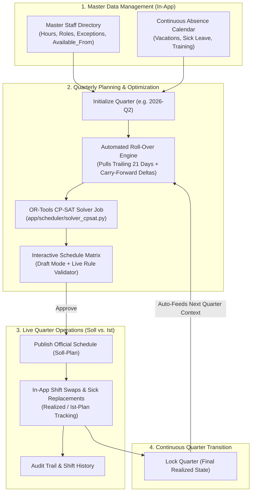
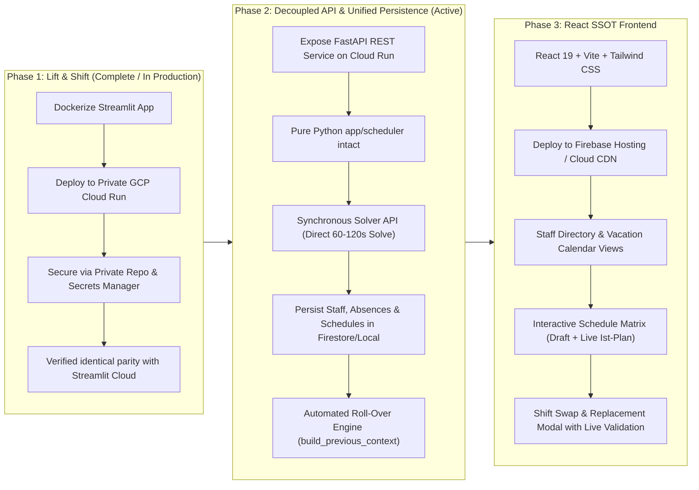
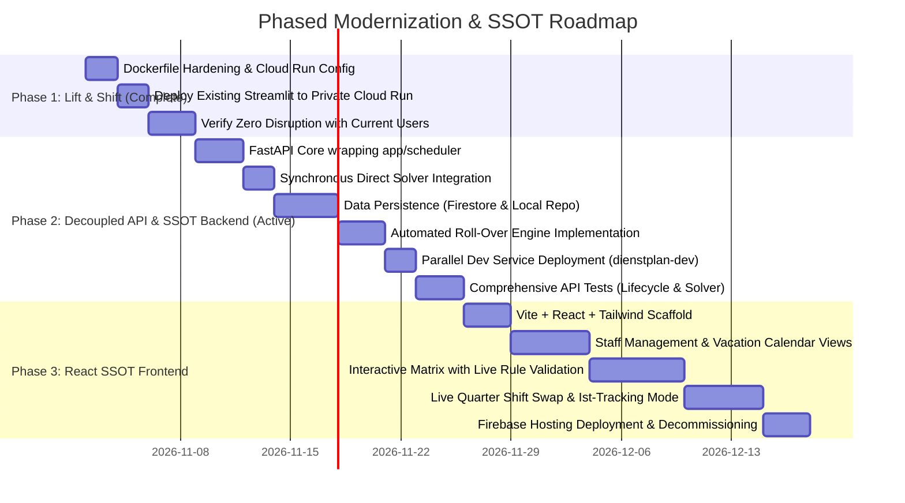

# Product Requirements Document (PRD)
# Cloud Run Deployment & Frontend Modernization Roadmap
## Transforming the Dienstplan Generator into a Unified Single Source of Truth (SSOT)

**Feature Name / Slug**: `gcp-cloud-run-migration-and-modernization`  
**Document Version**: 1.2 (Updated: Synchronous Direct Solve & Parallel Environment Architecture)  
**Status**: Approved & In Progress (Phase 1 Deployed; Phase 2 Active Development)  
**Target Architecture**: GCP Cloud Run (Containerized Backend) + GCP Managed Datastore (Firestore/Cloud Storage) + Modern React/Tailwind Frontend (Firebase Hosting)  
**Author**: Antigravity / Senior Cloud & Full-Stack Architect  

---

## 1. Executive Summary & Business Drivers

### 1.1 Motivation & Context
The **Dienstplan Generator** is currently written in Streamlit and deployed on Streamlit Community Cloud. While it successfully solves the complex mathematical optimization problem of fair quarterly emergency and night shifts using OR-Tools CP-SAT, its current operational workflow is that of a **"stateless calculator"**. 

This operational model suffers from two major categories of friction:

#### A. Cloud Infrastructure & Privacy Risks
1. **Repository Privacy & Data Sensitivity**: Streamlit Community Cloud enforces public repositories for free tier hosting. Even with sample data, hosting clinical shift scheduling logic, employee names, initials, and operational constraints in a public repository is unacceptable from an IP and data protection perspective. Migrating to Google Cloud Platform (GCP) allows keeping the source code and clinic data in a private repository and private container registry.
2. **Volatile Execution Environment**: Streamlit relies purely on in-memory `st.session_state`. When a browser tab is refreshed, or when the container sleeps/reboots, all in-session inputs (uploaded staff lists, vacations, trailing quarter contexts, and generated schedules) are lost.
3. **Compute & Solver Constraints**: The CP-SAT constraint programming solver (`ortools`) is CPU- and memory-intensive (runs typically 60–120 seconds). Running this inside a lightweight shared multi-tenant environment risks throttling, memory kills, or WebSocket disconnection.

#### B. Workflow Fragmentation & The "Excel Hell" Problem
Currently, the quarterly scheduling workflow requires extensive manual work **outside** the application:
1. **Disconnected Employee Rosters**: Planners maintain local `staff.csv` or `staff.xlsx` files. Updates to employee hours, new hires (`available_from`), departures, or qualification changes happen in local spreadsheets and must be re-uploaded every session.
2. **Disconnected Vacation Calendars**: Vacations are tracked separately in `vacations.xlsx` and manually fed into the app per quarter.
3. **Local Editing of the "Realized Schedule" (Ist-Plan)**: After the solver creates a plan and it is exported to Excel (`Dienstplan_2026_Q1.xlsx`), clinical reality intervenes during the quarter (sick leave, emergency shift swaps, staff departures). Planners currently edit these changes locally in Excel.
4. **Manual Cross-Quarter Bridging**: When planning the next quarter (e.g. Q2), the planner must remember to upload the manually edited *Arbeitseinsätze* Excel file from Q1 as the "Context File" (`build_previous_context_from_xlsx`). If this file is missing, formatted incorrectly, or outdated, **the 21-day rest constraint across the quarter boundary and the FTE carry-forward fairness deltas are completely lost**.

### 1.2 The Vision: A Single Source of Truth (SSOT)
The objective is to evolve the Dienstplan Generator from a stateless calculation tool into an **all-in-one cloud scheduling platform** for the clinic planning team:
- **Zero local spreadsheet dependencies** for recurring operations (Excel becomes an optional export format, not a storage medium).
- **In-app Master Staff Management** (hire dates, hours adjustments, roles, exceptions).
- **In-app Continuous Vacation & Absence Calendar**.
- **In-app Shift Swap & Sickness Tracking ("Soll vs. Ist")** during the active quarter.
- **Automated 1-Click Quarter Roll-Over**: When starting Q2, the system automatically pulls the locked realized shifts and trailing 21 days from Q1 to enforce boundary constraints and carry-forward fairness without any manual file juggling.

---

## 2. Complete Schedule Lifecycle Architecture

The following diagram illustrates how the target platform replaces external file hand-offs with an end-to-end cloud lifecycle:



### 2.1 Workflow Comparison: Today vs. Target SSOT Platform

| Step | Current Workflow (External Files) | Target SSOT Platform (In-App) |
|:---|:---|:---|
| **Staff Management** | Edit local `staff.csv`, upload per session | In-app Employee Management UI; changes persist automatically |
| **Vacation Tracking** | Edit local `vacations.xlsx`, upload per session | In-app Vacation Calendar; recurring & future leaves pre-stored |
| **Schedule Generation** | Streamlit button, browser blocks during solve | Direct synchronous solver API (`POST /quarters/{key}/generate`) within Cloud Run 300s timeout; candidate plan saved to database |
| **Manual Adjustments** | Export to Excel or use clumsy Streamlit widgets | Interactive React grid with drag-and-drop & live constraint feedback |
| **Quarter Operations** | Planners edit exported Excel file on desktop when shifts swap or sick leave occurs | Planners log swaps and sick replacements directly in the live schedule matrix |
| **Quarter Roll-Over** | Manually upload Q1 *Arbeitseinsätze* Excel into Q2 Streamlit session | 1-Click Roll-Over: system automatically reads Q1 realized shifts, builds `PreviousPlanContext`, and initializes Q2 |
| **Excel Role** | Primary storage & communication medium | Read-only export for noticeboard printouts and external archiving |

---

## 3. Phased Implementation Strategy

To protect ongoing clinical operations and avoid disruption, the transition remains structured in three safe phases:



- **Phase 1** has been successfully executed, deploying the existing Streamlit app to private Cloud Run with zero disruption to active scheduling.
- **Phase 2** builds the headless FastAPI layer, persistence store, and automated roll-over logic. In accordance with the "Flat & Simple" principle, the solver is invoked directly as a synchronous endpoint within Cloud Run's 300s timeout window, cutting out stateful job queues and polling infrastructure.
- **Phase 3** replaces Streamlit with the full single-source-of-truth React UI.
- **Parallel Deployment Model**: All Phase 2 and Phase 3 deployments target a separate Cloud Run service (`dienstplan-dev`) configured with `min-instances=0` ($0 idle cost), ensuring production (`dienstplan-app`) remains completely insulated from downtime or breaking changes.

---

## 4. Phase 1: Containerized Streamlit on GCP Cloud Run

### 4.1 Objectives
- Deploy the existing Streamlit app inside a secure, private GCP project.
- Host source code in a private GitHub repository; store containers in GCP Artifact Registry.
- Guarantee 100% feature parity with zero user disruption.

### 4.2 Cloud Run Service Specification
| Parameter | Specification | Rational / Justification |
|:---|:---|:---|
| **Service Name** | `dienstplan-app` | Primary scheduling service |
| **Region** | `europe-west3` (Frankfurt) or `europe-west1` (Belgium) | Low latency, strict EU GDPR compliance |
| **CPU Allocation** | 2 vCPU | Dedicated CPU cores for OR-Tools CP-SAT solver search threads |
| **Memory** | 2 GiB to 4 GiB | CP-SAT model construction and variable state space |
| **Execution Environment** | Second Generation (`gen2`) | Full Linux syscall and memory bandwidth compatibility |
| **Request Timeout** | 300 seconds (5 min) | Accommodates 120s solver execution limit without HTTP gateway timeouts |
| **Concurrency** | 5 to 10 | Streamlit runs on WebSockets; limits concurrent solver jobs per container |
| **Session Affinity** | Enabled (`--session-affinity`) | Critical for Streamlit WebSockets across client reconnects |
| **Min Instances** | 0 (cost-effective) or 1 (instant) | Min 0 scales to zero when idle; Min 1 eliminates cold-start latency |
| **Max Instances** | 3 | Prevents accidental cost runaway |

### 4.3 Container Hardening (`Dockerfile` Updates)
The updated `Dockerfile` for Phase 1 must support:
- Dynamic `$PORT` binding provided by Cloud Run with fallback to `8080`.
- Streamlit production flags (`--server.enableCORS=false`, `--server.headless=true`).
- Installing all required dependencies (`matplotlib`, `ortools`, `xlsxwriter`, `pandas`, `openpyxl`, `pydantic`).

```dockerfile
FROM python:3.11-slim

WORKDIR /app

# Prevent Python from writing .pyc and buffer output for Cloud Logging
ENV PYTHONDONTWRITEBYTECODE=1 \
    PYTHONUNBUFFERED=1 \
    PORT=8080

# Install dependencies
COPY pyproject.toml .
RUN pip install --no-cache-dir \
    streamlit>=1.30.0 \
    pandas>=2.1.0 \
    openpyxl>=3.1.0 \
    pydantic>=2.5.0 \
    python-dateutil>=2.8.0 \
    xlsxwriter>=3.0.0 \
    matplotlib>=3.8.0 \
    ortools>=9.15.6755

# Copy application source
COPY app/ ./app/

# Create data directory if not present
RUN mkdir -p /app/data

EXPOSE 8080

# Run Streamlit bound to Cloud Run dynamic $PORT
CMD ["sh", "-c", "streamlit run app/streamlit_app.py --server.port=${PORT} --server.address=0.0.0.0 --server.enableCORS=false --server.headless=true"]
```

### 4.4 Dual-Environment Cloud Run Strategy (Zero-Risk Parallel Deployments)
To enable active development and validation without risking production downtime or breaking changes to active scheduling sessions, the infrastructure uses two distinct Cloud Run services:
1. **Production Service (`dienstplan-app`)**:
   - Deployed from `main` branch.
   - Hosts the stable, user-facing scheduling application.
   - Min instances: 0 (or 1 during high-volume planning quarters).
2. **Preview / Development Service (`dienstplan-dev`)**:
   - Deployed from feature/modernization branches (`feat/gcp-modernization-redesign`).
   - Hosts experimental API routes, persistence layers, and preview frontends.
   - Min instances: 0 ($0 cost when idle).
   - Completely independent Cloud Run URL and configuration (`SERVICE_NAME="dienstplan-dev"`).

---

## 5. Phase 2: Decoupled API, Persistent Data Models & SSOT Engine

### 5.1 Objectives
- Expose a clean FastAPI REST backend wrapping [`app/scheduler/`](file:///home/e/Desktop/antigravity-projects/scheduling/app/scheduler/).
- **Synchronous Direct Solver Execution**: Runs OR-Tools CP-SAT directly within the HTTP request lifecycle (~60–120s), comfortably inside Cloud Run's 300s timeout window. This honors the "Flat & Simple" mandate by eliminating asynchronous job queues, task brokers, and polling state machines.
- Eliminate all manual file upload/download steps for inter-quarter scheduling.
- Implement an **Automated Roll-Over Engine** that auto-computes `PreviousPlanContext` directly from database records.

### 5.2 Core Data Models for Persistence

#### A. Master Staff Entity
```python
class StaffMember(BaseModel):
    id: str                        # Unique UUID or acronym (e.g. "STAFF_01")
    identifier: str                # 2-4 letter clinic acronym (e.g. "MUE")
    name: str                      # Full display name
    beruf: Beruf                   # TFA, AZUBI, INTERN, VET
    abteilung: Abteilung           # STATION, OP, OTHER
    hours: float                   # Weekly contracted hours (e.g. 40.0, 20.0)
    adult: bool = True
    reception: bool = False
    nd_possible: bool = True
    nd_alone: bool = True
    nd_min_consecutive: int = 2
    nd_max_consecutive: int | None = None
    nd_exceptions: list[int] = []  # Weekday blocks [0..6]
    birthday: str | None = None    # "MM-DD"
    available_from: date | None = None
    is_active: bool = True         # False if employee has left clinic
    created_at: datetime
    updated_at: datetime
```

#### B. Continuous Absence & Vacation Entity
```python
class AbsenceType(str, Enum):
    VACATION = "Vacation"
    SICK_LEAVE = "SickLeave"
    SPECIAL_LEAVE = "SpecialLeave"
    TRAINING = "Training"

class AbsenceRecord(BaseModel):
    id: str
    staff_id: str
    absence_type: AbsenceType
    start_date: date
    end_date: date
    note: str | None = None
```

#### C. Quarter Schedule & Realized Shift Lifecycle
```python
class ScheduleState(str, Enum):
    DRAFT = "DRAFT"               # Candidate plan being adjusted by planner
    PUBLISHED = "PUBLISHED"       # Official plan released to staff (Soll-Plan)
    ACTIVE = "ACTIVE"             # Currently ongoing quarter (accepting realized swaps)
    CLOSED = "CLOSED"             # Quarter concluded; locked for historical continuity

class ShiftAssignment(BaseModel):
    shift_date: date
    shift_type: ShiftType
    planned_staff_id: str         # Staff member originally assigned by solver/planner
    actual_staff_id: str          # Staff member who actually worked the shift
    is_paired: bool
    is_override: bool = False     # True if manually swapped/reassigned
    override_reason: str | None = None  # e.g. "Krankheitsvertretung", "Diensttausch"
    override_timestamp: datetime | None = None

class QuarterScheduleDocument(BaseModel):
    quarter_key: str              # e.g. "2026-Q2"
    year: int
    quarter: int
    state: ScheduleState
    config: SchedulerConfig
    assignments: list[ShiftAssignment]
    solver_metrics: dict          # Objective value, fairness deviation, solve time
    carry_forward_applied: list[CarryForwardEntry]
    trailing_applied: list[TrailingAssignment]
    created_at: datetime
    updated_at: datetime
```

### 5.3 Automated Roll-Over Engine Specification
In the current Streamlit app, cross-quarter bridging is handled by `build_previous_context_from_xlsx`. In the SSOT platform, this becomes an automated background method:

```python
def get_previous_quarter_context(target_year: int, target_quarter: int) -> PreviousPlanContext | None:
    """Auto-computes PreviousPlanContext from the preceding quarter document in database."""
    prev_year, prev_quarter = compute_preceding_quarter(target_year, target_quarter)
    prev_doc = datastore.get_schedule(f"{prev_year}-Q{prev_quarter}")
    
    if not prev_doc or prev_doc.state not in [ScheduleState.ACTIVE, ScheduleState.CLOSED, ScheduleState.PUBLISHED]:
        return None  # First quarter setup without historical context

    # Construct Schedule object using actual_staff_id (the REALIZED shift schedule)
    realized_schedule = Schedule(
        quarter_start=date(prev_year, (prev_quarter - 1) * 3 + 1, 1),
        assignments=[
            Assignment(
                shift=Shift(shift_type=a.shift_type, shift_date=a.shift_date),
                staff_identifier=a.actual_staff_id,
                is_paired=a.is_paired
            ) for a in prev_doc.assignments
        ]
    )
    
    active_staff = datastore.list_active_staff()
    # Call battle-tested core scheduling function directly:
    return build_previous_context(schedule=realized_schedule, staff_list=active_staff, trailing_days=21)
```

> [!IMPORTANT]
> The automated roll-over uses `actual_staff_id` (the realized shifts worked), ensuring that sick leaves or manual swaps that occurred in late March are automatically respected as rest-period constraints in early April!

### 5.4 REST API Endpoints Specification
| Method | Path | Description |
|:---|:---|:---|
| `GET` / `POST` | `/api/v1/staff` | List active staff or create a new employee |
| `GET` / `PUT` / `DELETE` | `/api/v1/staff/{staff_id}` | Retrieve, update or deactivate staff member |
| `POST` | `/api/v1/staff/bulk-import` | Optional one-time onboarding from `staff.xlsx` / `.csv` |
| `GET` / `POST` | `/api/v1/absences` | Query or record vacations and sick leaves across any date range |
| `GET` | `/api/v1/quarters/{quarter_key}` | Retrieve quarter schedule document, status, and metrics |
| `POST` | `/api/v1/quarters/{quarter_key}/init` | 1-Click Init: auto-detects preceding quarter, computes roll-over context |
| `POST` | `/api/v1/quarters/{quarter_key}/generate` | Direct synchronous CP-SAT solve (~60–120s within 300s timeout); returns generated `QuarterScheduleDocument` and metrics |
| `POST` | `/api/v1/quarters/{quarter_key}/shifts/swap` | Swap or reassign a shift with instant live constraint validation |
| `POST` | `/api/v1/quarters/{quarter_key}/publish` | Move state from `DRAFT` to `PUBLISHED` |
| `POST` | `/api/v1/quarters/{quarter_key}/lock` | Lock quarter into `CLOSED` state for permanent record |
| `GET` | `/api/v1/quarters/{quarter_key}/export` | 1-Click download of styled Excel (.xlsx) or CSV for noticeboard/staff |

---

## 6. Phase 3: Modern React Single Source of Truth Frontend

### 6.1 Objectives
- Provide a responsive, high-performance web UI eliminating all desktop spreadsheet manipulation.
- Integrate interactive schedule editing with instant constraint feedback.
- Provide clear views for both **Quarterly Planning (Soll)** and **Operational Tracking (Ist)**.

### 6.2 Key User Interface Views

```
┌────────────────────────────────────────────────────────────────────────┐
│  📅 DIENSTPLAN PLATFORM     [Personal]  [Urlaub]  [Q1 2026]  [Q2 2026] │
├────────────────────────────────────────────────────────────────────────┤
│  Status: 🟢 AKTIV (IST-STAND)       [Dienst tauschen]  [Excel Export]  │
│                                                                        │
│  APRIL 2026                                                            │
│  ┌────────────┬────────────────────────────┬─────────────────────────┐ │
│  │ Datum      │ Notdienst (Nacht)          │ Wochenende (Tag)        │ │
│  ├────────────┼────────────────────────────┼─────────────────────────┤ │
│  │ Mi 01.04   │ 👤 Vet: Dr. Müller         │ —                       │ │
│  │ Do 02.04   │ 👤 Vet: Dr. Müller         │ —                       │ │
│  │ Fr 03.04   │ 👤 TFA: Schmidt, K.        │ —                       │ │
│  │            │ 👤 Azubi: Bauer, L.        │                         │ │
│  │ Sa 04.04   │ 👤 TFA: Schmidt, K.        │ 👤 TFA: Weber, M.       │ │
│  │            │ 👤 Azubi: Bauer, L.        │ 👤 Intern: Dr. Koch     │ │
│  │            │ ⚠️ [Tausch: Bauer ➔ Klein] │                         │ │
│  └────────────┴────────────────────────────┴─────────────────────────┘ │
└────────────────────────────────────────────────────────────────────────┘
```

1. **Staff Directory & Qualifications Hub**:
   - Filterable table of clinic employees.
   - Edit contract hours, roles (TFA, Azubi, Intern, Vet), department locks, and night availability in a slide-over modal.
   - Add new employees with `available_from` date; deactivate departing staff.
2. **Interactive Absence & Vacation Planner**:
   - Visual team calendar showing who is away when.
   - Bulk add vacation blocks or mark single days off.
   - Immediate warning if an absence creates an impossible weekend or night coverage shortage.
3. **Draft Schedule Studio (Pre-Quarter Planning)**:
   - Run CP-SAT solver with 1 click. Displays active loading indicator during direct 60–120s execution; candidate assignments returned directly on completion.
   - Matrix grid showing candidate assignments.
   - Drag-and-drop or click to swap shifts.
   - **Live Rule Validation**: Any swap immediately evaluates [`app/scheduler/validator.py`](file:///home/e/Desktop/antigravity-projects/scheduling/app/scheduler/validator.py) and flags violations (e.g., "Violates 21-day rest gap" or "Exceeds max consecutive nights") before committing.
   - Comparison Drawer: Compare 2 solver runs side-by-side to choose the fairer plan.
4. **Live Quarter Operations ("Ist-Plan" Mode)**:
   - When a staff member falls sick or requests a shift trade, planners open the day, select the replacement staff, and enter a reason.
   - The system validates that the replacement staff does not violate safety/rest rules.
   - Both original assignment and actual replacement are retained in the audit history.
5. **1-Click Quarter Transition Wizard**:
   - "Start Planning Q3 2026":
     - Step 1: System reviews Q2 realized shifts and confirms Q2 is ready to lock.
     - Step 2: System automatically calculates carry-forward fairness deltas and 21-day trailing assignments.
     - Step 3: Generates Q3 plan with zero file uploads.

---

## 7. Migration & Rollout Plan



---

## 8. Summary of Added Requirements for SSOT

To achieve the single source of truth vision, the following items are now formally part of the PRD:
1. **Persistent Staff Master**: Replaces per-session `staff.csv` uploads with persistent CRUD entities.
2. **Continuous Absence Ledger**: Replaces quarterly `vacations.xlsx` uploads with an ongoing database ledger.
3. **Soll- vs. Ist-Tracking**: Adds shift swap and replacement logging directly into active schedules.
4. **Automated Roll-Over Engine**: Replaces manual `Arbeitseinsaetze.xlsx` context uploads with automated database queries feeding `build_previous_context(...)`.
5. **Excel Role Shift**: Excel is relegated from an operational storage format to a 1-click presentation/export format.
6. **Direct Synchronous Solver Execution**: Avoids async job queues and polling state machines by running OR-Tools CP-SAT synchronously within Cloud Run's 300s timeout.
7. **Zero-Risk Parallel Cloud Run Deployments**: Development and preview iterations deploy to `dienstplan-dev` with `min-instances=0` ($0 idle cost), guaranteeing zero disruption to the production service (`dienstplan-app`).
